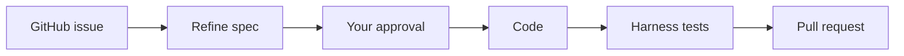

# patchbot

**Not a sandbox. Repository commands run as your user, with host filesystem and
network access. Use only repositories and toolchains you trust.**

patchbot turns a GitHub issue into a reviewed specification and a tested pull
request. It is a small Go portfolio project. It supports Anthropic, Gemini and
OpenAI-compatible servers. Version 0.1.0 runs locally through the CLI or web UI.



## Five-minute quickstart

You need Go 1.27 or newer and git 2.50.1 or newer. Set up access to a repository
you control and an issue before starting. Dependency downloads need network
access on the first build.

```sh
git clone https://github.com/aryanpappu/patchbot.git
cd patchbot
make build
cp patchbot.example.toml patchbot.toml
```

Edit `patchbot.toml`. Replace the repository entry and approver login. Set its
literal test argv. Choose a provider and model. Remove provider tables you will
not use. `limits.trusted_path` defaults to `/usr/bin` and `/bin`. Add the
existing absolute directories containing your Go toolchain and supported git
when needed. Every ancestor, including symlink locations, must be owned by root
or your user and have no group/world write bits. Keep data and workspaces
outside those tool directories.

Set `GITHUB_TOKEN` and the API key variable named in your provider table through
your usual secret manager or shell. The GitHub token needs issue and pull request
access, repository contents write access for publication, and collaborator
visibility. A dry run needs GitHub read access and local clone access.

```sh
./bin/patchbot doctor --config patchbot.toml
./bin/patchbot run --config patchbot.toml --repo owner/repo --issue 12 --dry-run
# Read the printed spec. Replace 1 with the run ID shown above.
./bin/patchbot approve 1 --config patchbot.toml
./bin/patchbot serve --config patchbot.toml
```

Approval continues through code and harness tests. The dry run prints the diff
and PR title/body. It creates a disposable local commit but publishes nothing.
It still calls the model and reads GitHub, and its tests still run host code.
Open <http://127.0.0.1:8080/runs/new> for the web UI. Stop the server with Ctrl-C.

For an offline demo with no real keys, run `make smoke`. It builds the binary,
creates temporary config/storage and a local bare repository, and drives the CLI
through refine → approve → code → test with a scripted provider and an httptest
GitHub server. It prints the PR text and checks that no branch or comment was
published. Modules must already be downloaded. The smoke test also runs with
`go test -tags smoke -run '^TestSmoke$' -v ./internal/runner`.

## Providers

The example lists every config key. Credentials are environment variables, never
TOML values. `patchbot models --provider NAME` lists live models with a config
fallback. These snippets show alternatives; use the matching defaults block.
Model IDs are examples. Check the list returned by your endpoint.

Anthropic uses the official Go SDK. Set `ANTHROPIC_API_KEY`:

```toml
[defaults]
provider = "anthropic"
refine_model = ""
code_model = ""

[providers.anthropic]
kind = "anthropic"
api_key_env = "ANTHROPIC_API_KEY"
default_model = "claude-sonnet-5-5"
```

Gemini uses the public REST API. Set `GEMINI_API_KEY`, list models, then set a
model ID. No Gemini model names are built in:

```toml
[providers.gemini]
kind = "gemini"
api_key_env = "GEMINI_API_KEY"
# Set models/default_model after running `patchbot models --provider gemini`.
```

Set `defaults.provider = "gemini"` and clear the two stage model overrides when
using its `default_model`. A run can also select `--provider gemini --model ID`.

For Ollama, install and start a local model that supports tools. Its server uses
the OpenAI-compatible adapter without an API key:

```toml
[providers.ollama]
kind = "openai"
base_url = "http://localhost:11434/v1"
models = ["qwen3-coder"]
default_model = "qwen3-coder"
price_free = true
```

Use `--provider ollama --model qwen3-coder`, or select it in defaults and clear
stage overrides. Other compatible endpoints use `kind = "openai"`, their full
API base URL and an `api_key_env` name. OpenAI, OpenRouter and Groq have automatic
request-field quirks. Local endpoints may omit `api_key_env`; doctor warns.

## CLI reference

All config-using commands accept `--config FILE`. Otherwise the loader searches
`$PATCHBOT_CONFIG`, `./patchbot.toml`, then `patchbot/config.toml` in the user
config directory. Unknown TOML keys fail. Precedence is flag > supported env
variable > file > embedded default. `config show` includes sources and masks keys.

| Command | Purpose |
| --- | --- |
| `run --repo owner/repo --issue N [--mode fix\|refine\|investigate] [--provider P --model M] [--dry-run]` | Refine and wait; investigate returns a read-only report |
| `approve ID` | Approve the current spec and execute |
| `revise ID --notes "..."` | Write a new spec version and wait again |
| `reject ID` / `cancel ID` | Close a waiting run / stop active work |
| `retry ID [--provider P --model M]` | Create a new run linked to a failed, cancelled or rejected run |
| `runs [--status S] [--sync]` | List runs; optionally check waiting GitHub commands once |
| `models [--provider P]` | List models with fallback warnings |
| `config check` / `config show` | Validate / print effective TOML and sources |
| `doctor [--online]` | Pass/warn/fail setup table; any fail exits 1 |
| `serve [--addr 127.0.0.1:8080]` | Serve the UI, JSON API and SSE |
| `version` / `help` | Build details / usage |

Supported env overrides are `PATCHBOT_CONFIG`, `PATCHBOT_DATA_DIR`,
`PATCHBOT_PROVIDER`, `PATCHBOT_MODEL`, `PATCHBOT_REFINE_MODEL`,
`PATCHBOT_CODE_MODEL`, `PATCHBOT_MAX_COST_USD`, `PATCHBOT_MAX_TURNS`,
`PATCHBOT_ADDR`, `PATCHBOT_LOG_LEVEL` and `PATCHBOT_LOG_FORMAT`.
`PATCHBOT_UI_TOKEN` protects the web API. `GITHUB_TOKEN` supplies GitHub auth.
Other API key variable names come from provider tables.

Doctor is offline by default. It checks Go/git versions, config, every configured
provider's key variable, `GITHUB_TOKEN`, 0700 data storage, 0600 SQLite storage,
migration checksums and command lookup under the trusted path. Invalid config
stops doctor before it runs tools or online checks. Git lookup uses the same
function and configured path as clone/push; data and workspace roots are
excluded. Version commands use `execx` with a five-second timeout, 4 KiB output
cap, process-group cleanup and bounded pipe draining. Missing new
storage is a warning; first use creates and migrates it. Doctor never migrates an
existing database. `--online` may only list models and call GitHub `/user`.

Run/control exit codes are 0 for success or waiting, 1 for failure or a draft PR,
2 for usage, 3 for an active-issue conflict and 130 for cancelled execution.

## Approval

Each spec has a version and SHA-256 hash. Approval names both. Code starts only
when the latest spec, approval, issue content and expiry checks agree. Editing
or revising creates a new version and clears approval. Changed issue title/body
requires refinement again. There is no pre-approve flag.

CLI and UI approvals use `approval.local_actor`; there is no login system.
GitHub `/approve` must be a new, unedited comment from a configured approver who
is also a repository collaborator. Bot comments and other authors are ignored.
`/revise notes` requests a new spec. Hand edits to the bot's spec comment are not
imported. Use revise or the UI editor. `serve` checks waiting runs every 60 seconds
by default; `runs --sync` checks once. Waiting runs expire after 14 days and allow
at most five revisions. Refine mode ends after approval without coding.

## Web UI

- `/runs/new`: allowlisted repo, issue, mode, provider/model, optional refine
  model, budget and dry-run controls. Dry run starts checked.
- `/runs`: filters, paging, status, cost, approval count and PR links.
- `/runs/ID`: spec editor/history, approval controls, timeline, live events,
  counters, diffs, test output, PR preview and retry controls.

Specs and model output appear as plain text. Vue 3.5.13 is pinned with SRI.
`server.vue_src = "local"` uses the included verified asset and works offline in
the browser. CDN mode is the default. `make vendor-vue` verifies a replacement
against the same hash before installing it; rebuild afterward.

The server binds loopback by default. Other addresses require
`PATCHBOT_UI_TOKEN`. Enter it in the page; it stays in sessionStorage for that
browser tab. Lock clears it. Every API, SSE and artifact request uses a bearer
header. Host checks, cross-origin mutation checks and CSP apply. Keep remote
access behind your own TLS and access controls. Closing the page does not cancel
a run. See the [API contract](internal/server/README.md).

## Limits and budgets

Defaults are 40 code turns, 20 refine turns, three test attempts, $2 per run,
two million tokens, 30 minutes of active time, two minutes per agent command and
ten minutes per harness test. Waiting does not consume active time. The budget
covers revisions too. The hard dollar ceiling defaults to $10. Commands store at
most 256 KiB and send at most 8 KiB to the model.

No prices are shipped. Add checked input/output rates per million tokens to the
provider's `prices` table. Missing prices mean unknown dollar cost and token-only
control. `price_free = true` explicitly records zero cost for local models.
Before each call the loop reserves the estimated worst case. Unknown usage stays
unknown in the UI.

The Unix entry point sets umask 077 for private creation defaults in git and
child processes. Commands are literal argv selected by ID, without a shell or
model-added args.
Trusted path entries must exist and resolve to directories outside data and
workspaces. Every directory from `/` through the resolved entry, and every
unresolved symlink location, must be owned by root or your user and have no
group/world write bits. Sticky directories receive no exemption. Doctor fails
if a command cannot resolve. File tools use an `os.Root` jail and protect `.git`,
`.env*`, `.github/workflows` and configured paths. Huge diffs are refused above
5 MiB per file or 50 MiB total.

The server runs two jobs with sixteen queued by default. Excess admission gets
HTTP 429. A limit reached with changes can produce a draft salvage PR after
harness tests. Cancellation, authentication errors and refusals publish nothing.
No diff means no PR. Missing tests or failed verification produce a draft.

Registered credentials of at least eight characters, including `PATCHBOT_UI_TOKEN`,
are masked before model input, persistence and CLI/API output. Shorter values
are ignored for substring masking; `config check` and `doctor` warn without
printing them. Redaction preserves harness phases, statuses and JSON/TOML keys.
Adapter request deadlines are retryable `unavailable` errors while caller
cancellation or deadlines stop retries.

## FAQ

**Can it work on any repository?** Only allowlisted repositories. The model
cannot add repositories or commands. Use ones you trust.

**Does a dry run spend money?** It can. It uses your configured model and runs
real tests. `make smoke` uses fakes and costs nothing.

**Does approval prove the patch is safe?** It approves the spec. Read the diff,
harness results and PR. The agent's claims do not replace the harness or review.

**Can I run it unattended or on a hostile repo?** This release is for one local
operator. It has no container isolation, webhooks, durable worker queue, login or
deployment system. Hostile repository code is outside its protection boundary.

**What happens after a crash?** Expired heartbeats become interrupted failures
at startup or maintenance. Retry creates a new run. A push followed by a failed
PR request needs manual inspection; there is no publication reconciliation.

## Development and license

`make ci` checks formatting, vet, lint, race tests and a CGO-free build.
`make smoke` runs offline acceptance. Go and lint caches can be put under
`/private/tmp` in a restricted workspace. CI also runs govulncheck with its live
vulnerability database. No real provider credentials are needed by tests.

See [architecture](docs/ARCHITECTURE.md), [security](SECURITY.md),
[contributing](CONTRIBUTING.md) and the [changelog](CHANGELOG.md).
Licensed under the [MIT License](LICENSE).
