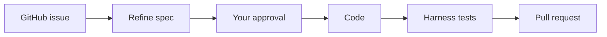

# patchbot

**Not a sandbox. Repository commands run as your user, with host filesystem and
network access. Use only repositories and toolchains you trust.**

patchbot turns a GitHub issue into a reviewed specification and a tested pull
request. It is a small Go portfolio project. It supports Anthropic, Gemini and
OpenAI-compatible servers. Version 0.1.0 runs locally through the CLI or web UI.



## Five-minute quickstart

You need Go 1.27 or newer and git 2.50.1 or newer. Set up access to a repository
you control and an issue before starting. Dependency downloads need network
access on the first build.

```sh
git clone https://github.com/aryanpappu/patchbot.git
cd patchbot
make build
cp patchbot.example.toml patchbot.toml
```

Edit `patchbot.toml`. Replace the repository entry and approver login. Set its
literal test argv. Choose a provider and model. Remove provider tables you will
not use. `limits.trusted_path` defaults to `/usr/bin` and `/bin`. Add the
existing absolute directories containing your Go toolchain and supported git
when needed. Every ancestor, including symlink locations, must be owned by root
or your user and have no group/world write bits. Keep data and workspaces
outside those tool directories.

Set `GITHUB_TOKEN` (or configure a GitHub App, see
[Set up the GitHub App](#set-up-the-github-app)) and the API key variable named in your provider table through
your usual secret manager or shell. The GitHub token needs issue and pull request
access, repository contents write access for publication, and collaborator
visibility. A dry run needs GitHub read access and local clone access.

```sh
./bin/patchbot doctor --config patchbot.toml
./bin/patchbot run --config patchbot.toml --repo owner/repo --issue 12 --dry-run
# Read the printed spec. Replace 1 with the run ID shown above.
./bin/patchbot approve 1 --config patchbot.toml
./bin/patchbot serve --config patchbot.toml
```

Approval continues through code and harness tests. The dry run prints the diff
and PR title/body. It creates a disposable local commit but publishes nothing.
It still calls the model and reads GitHub, and its tests still run host code.
Open <http://127.0.0.1:8080/runs/new> for the web UI. Stop the server with Ctrl-C.

For an offline demo with no real keys, run `make smoke`. It builds the binary,
creates temporary config/storage and a local bare repository, and drives the CLI
through refine → approve → code → test with a scripted provider and an httptest
GitHub server. It prints the PR text and checks that no branch or comment was
published. Modules must already be downloaded. The smoke test also runs with
`go test -tags smoke -run '^TestSmoke$' -v ./internal/runner`.

## Providers

The example lists every config key. Credentials are environment variables, never
TOML values. `patchbot models --provider NAME` lists live models with a config
fallback. These snippets show alternatives; use the matching defaults block.
Model IDs are examples. Check the list returned by your endpoint.

Anthropic uses the official Go SDK. Set `ANTHROPIC_API_KEY`:

```toml
[defaults]
provider = "anthropic"
refine_model = ""
code_model = ""

[providers.anthropic]
kind = "anthropic"
api_key_env = "ANTHROPIC_API_KEY"
default_model = "claude-sonnet-5-5"
```

Gemini uses the public REST API. Set `GEMINI_API_KEY`, list models, then set a
model ID. No Gemini model names are built in:

```toml
[providers.gemini]
kind = "gemini"
api_key_env = "GEMINI_API_KEY"
# Set models/default_model after running `patchbot models --provider gemini`.
```

Set `defaults.provider = "gemini"` and clear the two stage model overrides when
using its `default_model`. A run can also select `--provider gemini --model ID`.

For Ollama, install and start a local model that supports tools. Its server uses
the OpenAI-compatible adapter without an API key:

```toml
[providers.ollama]
kind = "openai"
base_url = "http://localhost:11434/v1"
models = ["qwen3-coder"]
default_model = "qwen3-coder"
price_free = true
```

Use `--provider ollama --model qwen3-coder`, or select it in defaults and clear
stage overrides. Other compatible endpoints use `kind = "openai"`, their full
API base URL and an `api_key_env` name. OpenAI, OpenRouter and Groq have automatic
request-field quirks. Local endpoints may omit `api_key_env`; doctor warns.

## CLI reference

All config-using commands accept `--config FILE`. Otherwise the loader searches
`$PATCHBOT_CONFIG`, `./patchbot.toml`, then `patchbot/config.toml` in the user
config directory. Unknown TOML keys fail. Precedence is flag > supported env
variable > file > embedded default. `config show` includes sources and masks keys.

| Command | Purpose |
| --- | --- |
| `run --repo owner/repo --issue N [--mode fix\|refine\|investigate] [--provider P --model M] [--dry-run]` | Refine and wait; investigate returns a read-only report |
| `approve ID` | Approve the current spec and execute |
| `revise ID --notes "..."` | Write a new spec version and wait again |
| `reject ID` / `cancel ID` | Close a waiting run / stop active work |
| `retry ID [--provider P --model M]` | Create a new run linked to a failed, cancelled or rejected run |
| `runs [--status S] [--sync]` | List runs; optionally check waiting GitHub commands once |
| `models [--provider P]` | List models with fallback warnings |
| `config check` / `config show` | Validate / print effective TOML and sources |
| `doctor [--online]` | Pass/warn/fail setup table; any fail exits 1 |
| `serve [--addr 127.0.0.1:8080]` | Serve the UI, JSON API and SSE |
| `memory list [--repo R] [--status S] [--kind K]` | List memory for allowlisted repositories (text truncated) |
| `memory show ID` | Print an entry's full text, content hash and audit history |
| `memory approve ID --hash PREFIX` | Approve a pending lesson; PREFIX is at least 8 hex characters of the hash shown by `show` |
| `memory reject ID` / `memory forget ID` `[--hash PREFIX]` | Reject a pending lesson / revoke any entry and erase its text |
| `memory add --repo R --text "..."` | Add an operator lesson (approved immediately) |
| `version` / `help` | Build details / usage |

Supported env overrides are `PATCHBOT_CONFIG`, `PATCHBOT_DATA_DIR`,
`PATCHBOT_PROVIDER`, `PATCHBOT_MODEL`, `PATCHBOT_REFINE_MODEL`,
`PATCHBOT_CODE_MODEL`, `PATCHBOT_MAX_COST_USD`, `PATCHBOT_MAX_TURNS`,
`PATCHBOT_ADDR`, `PATCHBOT_LOG_LEVEL` and `PATCHBOT_LOG_FORMAT`.
`PATCHBOT_UI_TOKEN` protects the web API. `GITHUB_TOKEN` supplies GitHub auth.
Other API key variable names come from provider tables.

Doctor is offline by default. It checks Go/git versions, config, every configured
provider's key variable, `GITHUB_TOKEN`, 0700 data storage, 0600 SQLite storage,
migration checksums and command lookup under the trusted path. Invalid config
stops doctor before it runs tools or online checks. Git lookup uses the same
function and configured path as clone/push; data and workspace roots are
excluded. Version commands use `execx` with a five-second timeout, 4 KiB output
cap, process-group cleanup and bounded pipe draining. Missing new
storage is a warning; first use creates and migrates it. Doctor never migrates an
existing database. `--online` may only list models and call GitHub `/user`.

Run/control exit codes are 0 for success or waiting, 1 for failure or a draft PR,
2 for usage, 3 for an active-issue conflict and 130 for cancelled execution.

## Approval

Each spec has a version and SHA-256 hash. Approval names both. Code starts only
when the latest spec, approval, issue content and expiry checks agree. Editing
or revising creates a new version and clears approval. Changed issue title/body
requires refinement again. There is no pre-approve flag.

CLI and UI approvals use `approval.local_actor`; there is no login system.
GitHub `/approve` must be a new, unedited comment from a configured approver who
is also a repository collaborator. Bot comments and other authors are ignored.
If the token's owner is also a configured approver (a single-user PAT), that
owner's own `/approve` counts; comments patchbot posted never do.
`/revise notes` requests a new spec. Hand edits to the bot's spec comment are not
imported. Use revise or the UI editor. `serve` checks waiting runs every 60 seconds
by default; `runs --sync` checks once. Waiting runs expire after 14 days and allow
at most five revisions. Refine mode ends after approval without coding.

## Repository memory

patchbot remembers two kinds of per-repository entries, keyed by the canonical
`owner/name`:

- **Typed observations** are written only by the harness after baseline and
  final verification: command ID, exit status, timeout flag, base/head SHA,
  command-policy digest, run ID, evidence reference and time. Command output is
  never stored. A changed command policy or an age above
  `memory.observation_ttl` makes an observation stale, and stale observations
  are not retrieved.
- **Lessons** are short prose (at most 600 bytes, redacted, printable
  characters plus newline and tab only; zero-width, bidi, tag, private-use and
  separator characters are refused). The code stage can propose up to three
  with `propose_lesson`; they stay `pending` until you review them with
  `patchbot memory show ID` and run `patchbot memory approve ID --hash PREFIX`,
  or approve in the UI, which sends the content hash it displayed. A decision
  applies only if the entry still has that repository and content hash. At most
  `memory.max_pending` (default 20) model lessons wait per repository; extra
  proposals and duplicates are dropped with a `memory.lessons_dropped` event.
  `memory add` stores your own lesson as approved. Only approved lessons are
  retrieved. Entries for repositories outside the allowlist are not listed and
  cannot be decided.

Each refine, investigate and code stage receives at most `max_entries` entries
and `max_bytes` bytes, chosen deterministically (no search, no use-count
ranking). Memory goes into the user turn as an `untrusted_data` block with a
note that it cannot override instructions, the approved spec or policy. It is
never in the system prompt, and it never changes allowed commands, protected
paths, repository scope or the approval gate. The selected IDs and content
hashes, plus the SHA-256 of the exact delivered text, are frozen per stage and
recorded as a `memory_selection` artifact and a `memory.selected` event, so
later approvals or forgets do not change a running stage. Failing to write an
observation or lesson never stops a run; it records a warning event.

`memory forget ID` revokes an entry and erases lesson text so it can never be
retrieved again. The content hash, audit actions (`memory_actions`), selection
records, any LLM transcript steps of runs that already used it, and existing
SQLite backups or WAL files are not rewritten. Set `[memory] enabled = false`
to stop all retrieval and writing; the `memory` commands still manage stored
entries.

## Independent review (opt-in)

`[review] enabled = true` adds a `review` phase after harness verification and
before publish. A separate read-only reviewer (refine tools plus
`submit_review`) sees the approved spec, the actual bounded workspace diff and
the harness test evidence, never the coder's summary, all as untrusted data. It
returns `approve` or `request_changes` with findings (`file`, `line`,
`severity`, `summary`) and a met/unmet assessment of every criterion ID. Each
verdict is stored bound to the spec hash and a diff hash (base SHA, complete
worktree tree ID and diff text).

`request_changes` triggers at most one coder repair cycle (`max_repairs`): the
findings reach the coder as untrusted feedback, the harness runs the tests once
more, and a fresh review checks the new diff. Publication recomputes the diff
hash and requires the committed tree to equal the last reviewed tree.

Review fails closed. A timeout, refusal, malformed verdict, exhausted budget or
a still-`request_changes` verdict never opens an ordinary PR: the run fails with
`review_failed`, or, with `salvage_draft = true`, opens a draft PR that states
review did not pass. Review approval never replaces the approval gate, the
harness tests or human review; failed tests still produce a draft.

Refine, code, review and repair share one budget, token limit and deadline.
`reserve_fraction` (default 0.15) is held back from coding so a review can
still run. The model defaults to the run's refine model. Approval freezes the
whole selection on the run; later config edits do not affect it, and runs
approved with review off stay unreviewed.

## Web UI

- `/runs/new`: allowlisted repo, issue, mode, provider/model, optional refine
  model, budget and dry-run controls. Dry run starts checked.
- `/runs/new` > **Write a new request**: repo, title and text. patchbot opens the
  GitHub issue (as the bot or PAT user; the public footer does not name you, the
  requester is kept only in the local database and run detail) and, with
  "Start refine now", starts the run. Nothing changes in the repository until
  you approve the specification. API: `POST /api/issues` with `repo`, `title`
  (1-256 chars), `body` (up to 64 KiB), `start_run` and a client-generated
  `idempotency_key`; resubmitting the same key returns the same issue and run.
- `/runs`: filters, paging, status, cost, approval count and PR links, plus a
  repository memory panel to list, approve, reject, forget or add lessons.
- `/runs/ID`: spec editor/history, approval controls, timeline, live events,
  counters, diffs, test output, review verdicts, PR preview and retry controls.

Specs and model output appear as plain text. Vue 3.5.13 is pinned with SRI.
`server.vue_src = "local"` uses the included verified asset and works offline in
the browser. CDN mode is the default. `make vendor-vue` verifies a replacement
against the same hash before installing it; rebuild afterward.

The server binds loopback by default. Other addresses require
`PATCHBOT_UI_TOKEN`. Enter it in the page; it stays in sessionStorage for that
browser tab. Lock clears it. Every API, SSE and artifact request uses a bearer
header. Host checks, cross-origin mutation checks and CSP apply. Keep remote
access behind your own TLS and access controls. Closing the page does not cancel
a run. See the [API contract](internal/server/README.md).

## Limits and budgets

Defaults are 40 code turns, 20 refine turns, three test attempts, $2 per run,
two million tokens, 30 minutes of active time, two minutes per agent command and
ten minutes per harness test. Waiting does not consume active time. The budget
covers revisions too. The hard dollar ceiling defaults to $10. Commands store at
most 256 KiB and send at most 8 KiB to the model.

No prices are shipped. Add checked input/output rates per million tokens to the
provider's `prices` table. Missing prices mean unknown dollar cost and token-only
control. `price_free = true` explicitly records zero cost for local models.
Before each call the loop reserves the estimated worst case. Unknown usage stays
unknown in the UI.

The Unix entry point sets umask 077 for private creation defaults in git and
child processes. Commands are literal argv selected by ID, without a shell or
model-added args.
Trusted path entries must exist and resolve to directories outside data and
workspaces. Every directory from `/` through the resolved entry, and every
unresolved symlink location, must be owned by root or your user and have no
group/world write bits. Sticky directories receive no exemption. Doctor fails
if a command cannot resolve. File tools use an `os.Root` jail and protect `.git`,
`.env*`, `.github/workflows` and configured paths. Huge diffs are refused above
5 MiB per file or 50 MiB total.

The server runs two jobs with sixteen queued by default. Excess admission gets
HTTP 429. A limit reached with changes can produce a draft salvage PR after
harness tests. Cancellation, authentication errors and refusals publish nothing.
No diff means no PR. Missing tests or failed verification produce a draft.

Registered credentials of at least eight characters, including `PATCHBOT_UI_TOKEN`,
are masked before model input, persistence and CLI/API output. Shorter values
are ignored for substring masking; `config check` and `doctor` warn without
printing them. Redaction preserves harness phases, statuses and JSON/TOML keys.
Adapter request deadlines are retryable `unavailable` errors while caller
cancellation or deadlines stop retries.

## Set up the GitHub App

PAT mode (`[github] auth = "pat"`, the default) is fine for local use and a
small pilot. For a shared host, use a GitHub App: each run gets a 1-hour token
that can touch only that run's repository, and comments come from a distinct
`<slug>[bot]` identity, so the owner's own `/approve` counts normally.

### Connect GitHub (recommended)

The dashboard creates the App for you through GitHub's App manifest flow. You
never see or copy the private key: GitHub hands it to patchbot, which writes it
straight to a `0600` file.

1. Prepare the key directory once, owned by the service user and outside the
   data directory (patchbot never creates it and never overwrites an existing
   key):

   ```sh
   sudo install -d -o patchbot -g patchbot -m 0700 /srv/patchbot
   ```

2. Configure; there is no `app_id` yet and no key file:

   ```toml
   [github]
   auth = "app"
   private_key_file = "/srv/patchbot/github-app.pem"
   setup_public_url = "https://patchbot.example.org"   # where GitHub can redirect your browser
   # setup_app_name = "my-patchbot"   # optional; default patchbot-<6 random chars>
   ```

   `setup_public_url` is the origin you open the dashboard on (an https URL, or
   http for localhost). Behind a reverse proxy or tunnel, forward a `Host` that
   patchbot accepts (the same requirement as for the dashboard itself).

3. Start `patchbot serve`. Without an App it starts in setup mode: the dashboard
   works, but new runs are refused with "GitHub is not connected yet", and
   `patchbot doctor` reports "not connected, open /setup/github".
4. Open `/setup/github` (sign in on the Runs page first when `PATCHBOT_UI_TOKEN`
   is set), click **Connect GitHub**, review the App on GitHub (private, no
   webhook, no events, only contents/issues/pull requests write and metadata
   read) and confirm. GitHub sends your browser back to
   `/setup/github/callback`; patchbot exchanges the one-time code, writes the
   key, and records only the App ID and slug in its database.
5. Click the **Install** link on the result page and choose **Only select
   repositories**: the ones listed under `[repos]`. Use **Re-check status** to
   see the installations (`GET /api/github/status`).
6. Restart patchbot (`systemctl restart patchbot`) so it starts using the App,
   then run `patchbot doctor --online`.

Setup is available only until GitHub is connected: it refuses to run if
`app_id` is set, the database already has an App, or the key file exists. To
start over, delete the App on GitHub, then remove the key file and the
`github_app` row deliberately. The client secret and webhook secret that GitHub
returns are discarded, not stored; if you later enable a webhook on the App,
set a new webhook secret in the App settings and in `[webhook]`.

### Manual setup (alternative)

Use this to reuse an existing App or when the server is not reachable from your
browser by a stable URL.

1. GitHub → Settings → Developer settings → GitHub Apps → **New GitHub App**.
   Any name (its slug becomes the bot login, for example `patchbot[bot]`).
   Homepage URL: anything. **Webhook: not needed** — untick "Active" (you can
   enable it later for the optional webhook ingress below).
2. Repository permissions — exactly these, nothing else:
   **Contents: Read and write**, **Issues: Read and write**,
   **Pull requests: Read and write**, **Metadata: Read-only** (mandatory).
   No organization or account permissions. No events needed.
3. "Where can this GitHub App be installed?": **Only on this account**.
4. Create it, note the **App ID**, then **Generate a private key** (a `.pem`).
5. **Install App** → choose **Only select repositories** and pick the repos you
   list under `[repos]`. Do not install on all repositories.
6. Place the key on the server, readable only by the service user, outside the
   data directory and workspaces, and delete the downloaded copy:

   ```sh
   sudo install -o patchbot -g patchbot -m 0600 ~/Downloads/patchbot.*.private-key.pem /srv/patchbot/github-app.pem
   shred -u ~/Downloads/patchbot.*.private-key.pem
   ```

7. Configure and check:

   ```toml
   [github]
   auth = "app"
   app_id = 123456
   private_key_file = "/srv/patchbot/github-app.pem"
   ```

   ```sh
   sudo -u patchbot ./bin/patchbot doctor --config patchbot.toml --online
   ```

   Doctor checks the key file (regular, 0600 or stricter, owned by patchbot,
   outside data), signs a JWT locally, and online confirms the App identity and
   that every allowlisted repository has the App installed with all four
   permissions, minting a single-repository token for each. Unset `GITHUB_TOKEN`
   in app mode; it is ignored and there is no fallback to it.

Commits are authored by `<slug>[bot] <ID+<slug>[bot]@users.noreply.github.com>`.
To rotate the key: generate a second key in the App settings, replace the file,
restart patchbot, run `doctor --online`, then delete the old key on GitHub.

## Optional GitHub webhooks

Webhooks and label polling are off by default. To enable them, export a strong
`PATCHBOT_WEBHOOK_SECRET`, set `[webhook] enabled = true`, and configure GitHub
with that same secret, JSON payloads, and **Issues** / **Issue comments** events
at `/hooks/github` (or your configured `webhook.path`). Keep the UI protected;
the webhook path uses its HMAC signature instead of the UI bearer token.

By default, `ai-refine`, `ai-fix`, and `ai-investigate` start their corresponding
modes only in allowlisted repositories. Labels never approve coding. Comments
still pass all existing approval/revision checks. Polling recovers missed hints;
delivery receipts survive restart. Repeated hints and persistent labels do not
restart completed work. An observed removal/change rearms a trigger; otherwise
use an explicit retry. Multiple matching labels use lexical order. Requests
larger than 1 MiB are refused. Enabling webhooks does not start runs for issues
that already carry a trigger label: the first label sweep of each repository is
a baseline, and only labels added afterwards start work. Label sweeps run every
`webhook.label_poll_interval` (default 5m).

## FAQ

**Can it work on any repository?** Only allowlisted repositories. The model
cannot add repositories or commands. Use ones you trust.

**Does a dry run spend money?** It can. It uses your configured model and runs
real tests. `make smoke` uses fakes and costs nothing.

**Does approval prove the patch is safe?** It approves the spec. Read the diff,
harness results and PR. The agent's claims do not replace the harness or review.

**Can I run it unattended or on a hostile repo?** This release is for one local
operator. It has no container isolation, durable worker queue, login or
deployment system. Hostile repository code is outside its protection boundary.

**What happens after a crash?** Expired heartbeats become interrupted failures
at startup or maintenance. Retry creates a new run. A push followed by a failed
PR request needs manual inspection; there is no publication reconciliation.

## Development and license

`make ci` checks formatting, vet, lint, race tests and a CGO-free build.
`make smoke` runs offline acceptance. Go and lint caches can be put under
`/private/tmp` in a restricted workspace. CI also runs govulncheck with its live
vulnerability database. No real provider credentials are needed by tests.

See [architecture](docs/ARCHITECTURE.md), [security](SECURITY.md),
[contributing](CONTRIBUTING.md) and the [changelog](CHANGELOG.md).
Licensed under the [MIT License](LICENSE).
