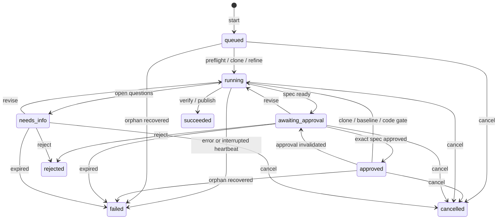

# Architecture

patchbot is a local Go application. The CLI and web API use the same runner,
approval gate and SQLite store. The model proposes tool calls. Go code decides
whether each call and lifecycle transition is allowed.

## Package map

| Package | Responsibility |
| --- | --- |
| `cmd/patchbot`, `internal/cli` | Entry point, flags, doctor, synchronous controls and server startup |
| `internal/config`, `secret`, `logging`, `version` | Layered TOML, credential masking, safe slog and build metadata |
| `internal/runner` | Preflight, workspace lifetime, budgets, approval, recovery and publication |
| `internal/agent` | Refine/investigate/code loops, typed approval gate, harness and recording |
| `internal/llm` | Provider interface, ordered parts, retries, schemas, models and integer pricing |
| `internal/llm/{anthropic,gemini,openai,fake,providers}` | Adapters, scripted tests and constructor wiring |
| `internal/tools` | Schema-checked file/command tools and terminal submissions |
| `internal/workspace` | `os.Root` jail, protected paths and private workspace management |
| `internal/execx` | Immutable command policy, trusted PATH, clean env and process groups |
| `internal/gitx`, `github` | Guarded local git and bounded GitHub REST client |
| `internal/store` | SQLite records, transactions, migrations and committed-event notifications |
| `internal/server` | Admission, worker lifetime, HTTP API, auth, SSE and maintenance |
| `internal/web` | Embedded templates, Vue asset, UI JS/CSS and verified vendoring command |
| `internal/testhttp`, `workspace/wstest` | Offline HTTP and jail test fixtures |

## Run lifecycle

`phase` distinguishes preflight, clone, refine, baseline, code, verify and publish.
Clone/baseline after approval retain `approved` until the typed code gate claims
execution. Refine mode stops after spec approval. Investigate uses read-only
tools and returns a report. A dry run executes locally and stores publication
artifacts without GitHub writes or pushes.

Refine records the issue hash and base SHA, then removes its checkout while
waiting. Approval re-clones at that SHA. A dirty baseline checkout is discarded
and re-cloned. The harness runs configured tests after submission, with at most
three attempts. It can feed failed output back to the agent. Salvage creates a
draft only when policy allows it. An empty diff records `no_changes` as an
outcome. Terminal status alone does not describe the outcome.

The server owns detached worker contexts. It reserves bounded queue capacity
before committing controls, serializes work per run and maintains heartbeats
for queued and executing jobs. Shutdown stops admission and drains work for up
to 30 seconds in the CLI, then cancels. Startup and maintenance recover stale
owners. SQLite allows only one active run per repository issue.

## Data model

SQLite uses modernc, WAL, foreign keys and one writer connection. Embedded,
forward-only migrations have a ledger with names and SHA-256 checksums. Normal
store opening migrates. Doctor opens read-only and checks the complete ledger.
Times are UTC milliseconds; money is integer micro-USD. NULL means unknown.

| Table | Records |
| --- | --- |
| `runs` | Issue, mode, models, status, phase, outcome, base/head, PR, frozen limits, totals and heartbeat/generation |
| `specs` | Versioned canonical draft, markdown, content hash, issue hash, notes and comment provenance |
| `approvals` | Exact version/hash, decision, actor, channel and time |
| `questions` | Spec questions and recorded answers |
| `steps` | Capped, redacted LLM/tool/test/git evidence and measured usage |
| `run_events` | Per-run sequence, type and JSON payload for replay |
| `run_artifacts` | Redacted spec/report/diff/test/PR previews and private accounting artifacts |
| `actions` | Local and GitHub lifecycle decisions |
| `schema_migrations` | Applied version, filename, checksum and time |

Status changes use compare-and-set with a generation counter. Decisions and
associated events/actions commit atomically. Public artifact downloads allow a
fixed set of kinds. Internal accounting artifacts are not exposed.

## Approval gate

A stored boolean could survive a spec edit. The gate instead checks the latest
spec version/hash against the approval and current issue hash. It checks expiry,
mode and lifecycle state too. Revisions and UI edits invalidate old approval.
GitHub comments count only from configured collaborator approvers and must be
unedited. The bot's spec comment is checked for tampering, never imported.

`agent.Check` returns a private approval-token type whose fields callers cannot
construct. The code stage and code-tool registry require that token. They repeat
validation at the boundary. Compile-failure tests prove callers cannot enter
coding or register write tools without it. The runner also checks approval and
issue freshness before publication. This keeps prompts and HTTP handlers from
turning an intent to approve into write authority.

## Events and SSE

Records commit before notifications fire. Notifications carry wake-up hints;
SQLite is the replay source. SSE subscribes before reading ordered batches,
replays after `Last-Event-ID` (or `after`), and resumes without gaps or duplicates.
A one-second poll repairs missed hints. Each connection has a bounded notification
queue. Slow clients disconnect rather than block writers. Heartbeats are every
15 seconds and socket writes have five-second deadlines. Terminal streams drain
finishing worker events before closing. Disconnecting a browser leaves work
running.

The UI uses fetch streams to attach bearer headers. It keeps up to 1,000 recent
events per tab and reloads persisted detail. JSON value redaction preserves keys and
JSON validity and number precision. Bootstrap state uses escaped Go templates.

## Security model

This is not a sandbox. Repo code runs with the operator's host permissions and
network access. File-tool restrictions and clean environments reduce accidental
or model-directed access. They cannot contain a malicious test executable.

- Repositories and literal command IDs come from operator config. There is no
  model shell, git or GitHub tool. Trusted entries must exist and resolve to
  directories outside data and actual workspaces. Every ancestor from `/`,
  including unresolved symlink locations, must be root/current-user owned and
  have no group/world write bits; sticky bits do not exempt a directory. Defaults
  are `/usr/bin` and `/bin`. Policy resolution and child PATH use one list.
  Doctor stops immediately on invalid config. Doctor and production git share
  one resolver using `limits.trusted_path` and the same exclusions.
- The `os.Root` jail rejects escapes and protected paths, including symlink and
  Unicode aliases. `.git`, `.env*`, workflows and configured paths are protected.
  New files/dirs use 0600/0700; rewrites retain only owner permission bits.
- The Unix binary sets umask 077 once before starting workers. Git and tests
  inherit it. Embedders must set their own process creation mask.
- Commands have bounded output, explicit env, private HOME/TMP and process
  groups. Cancellation sends TERM, retains the leader through the full grace
  period and sends KILL before reaping. Non-reaping exit observation keeps the
  zombie leader's PID/PGID reserved until all group signaling finishes, so
  signals cannot hit a reused group. Ordinary exits also kill remaining group
  members before Wait. Git shares this lifecycle. Doctor version commands use
  `execx`, a five-second timeout, 4 KiB output cap and WaitDelay.
  Children that deliberately escape the group are outside
  this model. Repository processes can create files or contact the network.
- Git requires version 2.50.1 or newer. Credentials appear only in clone/push
  `GIT_CONFIG_*` auth headers, never URLs, argv or `.git/config`. Hooks are off,
  submodules are refused, config is hash-checked, diffs are bounded and pushes
  allow only `patchbot/*`, without force or the default branch.
- Redaction runs before logs, SQLite, model tool results, SSE, API/CLI output and
  PR bodies. All CLI/server runners receive the full redactor, including the
  UI token when set. Registered credentials require at least eight characters;
  shorter values are ignored for substring masking, and config check/doctor
  warn without printing the value. Encoded variants are registered too.
  Harness phase/status enums and JSON/TOML keys are preserved; credential-bearing
  string values are redacted before serialization. HTTP bodies and deadlines
  are bounded, including SDK reads. Adapter-owned deadlines produce retryable
  `unavailable` errors; caller cancellation/deadlines stop retries.
  Unknown transformed secrets
  are not guaranteed detectable. Issue/repo/test text is untrusted prompt data.
- Loopback is the default web bind. Other binds require a token. API/SSE/artifact
  routes require bearer auth when enabled. Public shells contain no private
  bootstrap data in token mode. Host checks, cross-origin mutation protection,
  CSP, pinned SRI and plain-text model output protect the browser boundary.
  Remote TLS, operator identity and deployment isolation are external concerns.

See [SECURITY.md](../SECURITY.md) for scope and reporting.

## Extension seams

These are the PLAN section 10 boundaries, not features promised in v0.1.0.

| Next step | Existing boundary |
| --- | --- |
| Webhooks and label polling | `Runner.Start`, `runs.trigger`; add HMAC checks and delivery dedupe |
| Durable queue and worker leases | Runner `Admit`/`Dispatch` hooks, queued status and heartbeat; current server queue is in memory |
| Docker execution | `execx.Executor` is separate from `workspace.Workspace` |
| GitHub App tokens | `github.TokenSource`, shared by git and API |
| Deployment, login and backup | Server auth wrapper, HTTP handler boundary and on-disk SQLite |
| Other managed runners and PR follow-ups | `llm.Provider`, constructors and runner lifecycle methods |

Provider adapters preserve opaque thinking/signature parts in live conversations
while omitting them from transcripts. Tools implement one schema/execute
interface. Storage and executor interfaces keep tests offline and leave room
for other implementations without weakening the approval boundary.
